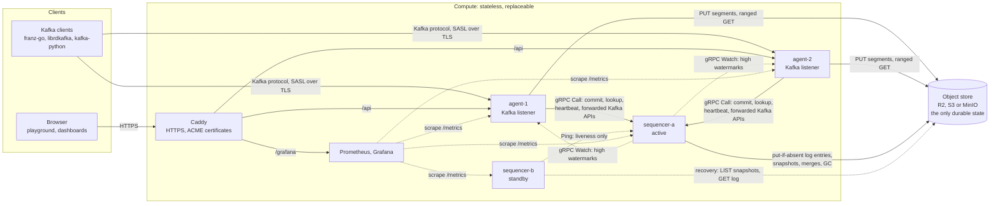
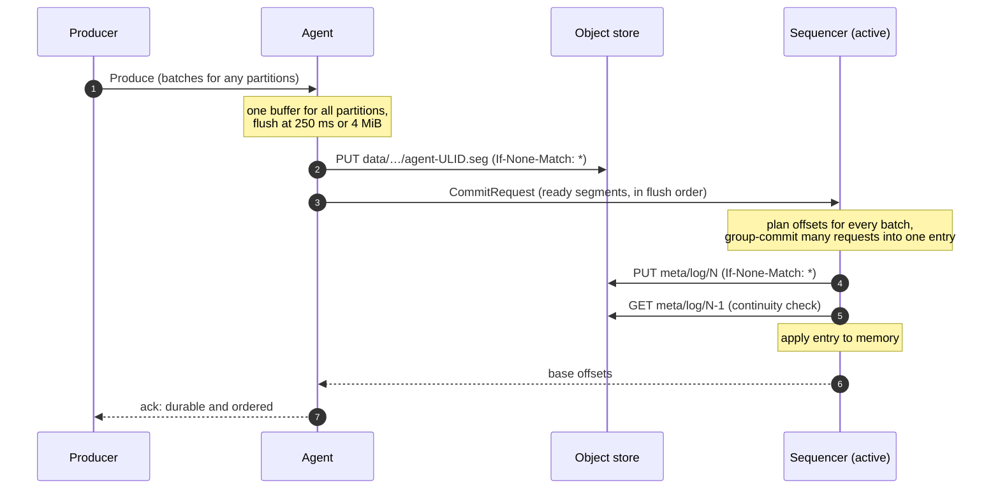
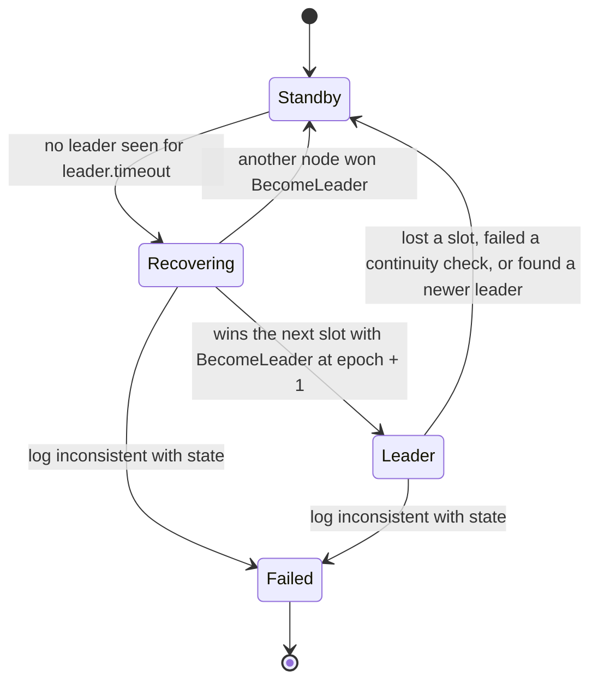

# Sluice

[](https://github.com/ayushhh1010/sluice/actions/workflows/ci.yml)
[](https://github.com/ayushhh1010/sluice/actions/workflows/nightly.yml)

**A Kafka-compatible streaming log with no broker disks.** Object storage is the only durable layer.

[Design](docs/DESIGN.md) · [Decision records](docs/adr) · [Benchmarks](docs/BENCHMARKS.md) · [Bugs the simulator found](docs/BUGS.md) ·
[Runbook](docs/RUNBOOK.md)

## Overview

Sluice is a Kafka-compatible streaming log with no broker disks. Agents speak the Kafka protocol and hold no durable state, a single
sequencer orders everything through a metadata log, and an S3-compatible bucket (Cloudflare R2, MinIO or AWS S3) is the only durable
layer.

Unmodified Kafka clients produce, consume and run consumer groups against it, and a deterministic simulator plus a history checker back
the claim that no acknowledged record is ever lost.

The whole design rests on one rule: **nothing is acknowledged until it is durable in object storage and ordered in the metadata log.**
Everything else (agents, sequencers, caches) can be killed at any moment, and a fresh machine pointed at the bucket is a full disaster
recovery.

What it trades away: latency. A diskless log acknowledges in hundreds of milliseconds, not single digits, because every acknowledgement
waits for object-store writes (see [Benchmarks](#benchmarks)).

## Architecture

### System context



### Components

| Component | Responsibility | State it holds | If it dies |
| --- | --- | --- | --- |
| **Agent** | Kafka protocol (Produce, Fetch, SASL, quotas), batching produces into segments, serving fetches | Caches only: tail cache, batch index, data LRU | Clients get retriable errors and reconnect to another agent; nothing acknowledged is lost |
| **Sequencer (active)** | Assigns offsets, appends the metadata log, runs consumer groups, idempotent-producer state, merging, retention, GC | In-memory state rebuilt from the bucket | The standby recovers from the newest snapshot plus the log and takes over |
| **Sequencer (standby)** | Watches the leader with pings; takes over after `leader.timeout` | None | Nothing, until it is needed |
| **Object store** | Segments, metadata log entries and snapshots, all immutable | Everything that matters | Outage: there is no durability without it |
| **Caddy** | TLS for the web endpoints; issues the certificates the agents' Kafka listeners hot-reload | Certificates (re-issuable) | Web UI is down; Kafka clients keep working until certificates expire |

The internal RPC surface is deliberately two methods: `Call`, one envelope for every request, and `Watch`, a stream of commit
notifications. Kafka APIs that the sequencer owns (Metadata, topics, groups, offsets, producer IDs) are forwarded as raw Kafka bytes, so
each API has exactly one implementation ([DESIGN §14](docs/DESIGN.md#14-forwarding-kafka-apis-to-the-sequencer)).

### Storage layout

```
sluice/<cluster>/data/<yyyy>/<mm>/<dd>/<agent>-<ulid>.seg      agent segments: batches for many partitions
sluice/<cluster>/merged/<topic-id>/<partition>/<base>-<ulid>.seg
sluice/<cluster>/meta/log/<seq:020d>.entry                    metadata log, one immutable object per entry
sluice/<cluster>/meta/snap/<seq:020d>.snap                    sequencer snapshots
```

Every object is written once. Sequence numbers are zero-padded so lexical order is numeric order, and there is no mutable head pointer.

### Write path



Group commit happens at three levels: one segment per flush carries every partition, one commit request carries every segment that
finished uploading, and one log entry carries every request that arrived during the previous append. Object-store writes therefore scale
with agents and flush windows, not with partitions or clients
([DESIGN §6](docs/DESIGN.md#6-group-commit-at-three-levels)).

Batches are stored exactly as the client sent them. Kafka's batch CRC does not cover the base offset, so a fetch patches the assigned
offset into a copy of the header, and nothing is ever re-encoded, re-checksummed or decompressed.

### Read path

The agent that owns a partition (rendezvous hashing over live agents; ownership is a cache-locality hint, never a correctness
requirement) serves a fetch from the first layer that has it:

1. **Tail cache:** batches the agent committed itself, so consumers at the tail never touch object storage.
2. **Batch index and data LRU:** batch locations from earlier lookups, and object byte ranges (512 MiB by default).
3. **Lookup and ranged GET:** the sequencer returns batch locations, and the agent reads only the byte ranges it needs, with adjacent
   ranges coalesced.

A fetch at the high watermark long-polls until a `Watch` notification or `MaxWaitMs`.

### Fencing and the sequencer lifecycle



There is no consensus service. Storage decides who wins, and leases only decide who tries:

* **Only one writer can create `meta/log/N`** (`If-None-Match: *`), and a sequencer writes N only after applying everything below it.
  Two sequencers that both believe they lead cannot diverge: the loser gets a 412, reads the winner's entry and steps down.
* **Log garbage collection is safe without clocks.** Put-if-absent proves a slot is empty, not that it was never written. So GC deletes
  entries in ascending order, a writer that wins slot N confirms N−1 is byte-identical to what it applied, and a leader that sees an
  empty next slot confirms its own last entry is still there before it trusts that it still leads. Recovery starts from the newest
  snapshot found by LIST. Four of the bugs in [BUGS.md](docs/BUGS.md) lived here; the argument is in
  [DESIGN §3](docs/DESIGN.md#3-garbage-collecting-a-put-if-absent-log).
* **Linearizable where it matters.** OffsetFetch waits for a read barrier that proves no newer leader exists. Fetch and Metadata answer
  without one, because a stale answer there is a prefix of the truth, which Kafka clients already handle.
* **Fail-stop.** A sequencer that finds an entry contradicting the state it applies to stops instead of guessing.

### Failure model

| Failure | What clients see | Why nothing acknowledged is lost |
| --- | --- | --- |
| Agent crash | Retriable errors; clients refresh metadata and move to a live agent (longest produce stall measured: 3.5 s) | The agent acknowledged nothing that was not already in the bucket and the log |
| Active sequencer crash | Commits pause until the standby takes over (measured ~3.7 s after a `kill -9`) | The new leader rebuilds state from the newest snapshot plus the log |
| Zombie leader (paused past its lease, then resumes) | Nothing | Its next append loses the slot or fails the continuity check; its probes see that the log moved past it |
| Lost response (write applied, reply lost) | A retry | Retries reuse the object key and get the original answer; idempotent producers deduplicate |
| Storage brownout (503s, slow PUTs) | Higher latency, possibly `REQUEST_TIMED_OUT` | Nothing is acknowledged before it is durable; a timed-out request may still commit (at-least-once, as in Kafka) |
| Sequencers cut off from each other, both reach storage | Possible leadership churn | Storage arbitrates every slot; losers step down on their next append |
| Machine lost | Outage until a new machine starts | The bucket is the whole state |

Safety is clock-free except for two garbage-collection margins, each at least 1.5× the longest segment age
([DESIGN §7](docs/DESIGN.md#7-retries-deduplication-and-the-two-clock-assumptions)).

### Correctness: the invariants

The agent and sequencer are sans-I/O state machines (`Step(now, event) → []effect`). The simulator runs the same code single-threaded
in virtual time with a fault-injecting network and object store, and every failure replays from one 64-bit seed. The checker verifies
these invariants from the client history and the final bucket:

| | Invariant |
| --- | --- |
| I1 | Every acknowledged record is in the final log at its acknowledged offset |
| I2 | No record appears twice unless its producer retried (never for idempotent producers), and nothing appears that was not produced |
| I3 | Each partition's offsets are dense from log start to the high watermark |
| I4 | Every fetch response is a contiguous slice of the final log |
| I5 | OffsetFetch returns the last acknowledged OffsetCommit |
| I6 | Replaying the metadata log from any retained snapshot yields the same state as recovery |
| I7 | No live batch ref points at a deleted object |
| G1 | Within one group generation, no partition has two owners |

Four planted bugs (`-tags sluice_bugs`) prove the checker is not vacuous, and CI replays every seed twice to prove determinism.

## Key design decisions

Each has a decision record with the alternatives and trade-offs.

| Decision | Why | Cost accepted |
| --- | --- | --- |
| [Metadata lives in object storage](docs/adr/002-metadata-in-object-storage.md), not Postgres or etcd | No extra stateful service; storage fences zombies; disaster recovery needs only the bucket | A PUT and a GET per log entry, hence group commit; GC needs care (ADR-007) |
| [One active sequencer](docs/adr/003-one-active-sequencer.md) | One totally ordered log is simple to reason about and to verify | A throughput ceiling of log entries per second; [DESIGN §17](docs/DESIGN.md#17-where-the-design-stops-scaling) sketches sharding |
| [Raw Kafka batches, offsets rewritten on read](docs/adr/004-raw-batches.md) | No re-encoding, CRC recomputation or decompression; batches upload before they have offsets | Fetch patches each batch header |
| [`acks=1` behaves like `acks=all`](docs/adr/005-acks.md) | There is one durability level: in the bucket and in the log | No faster, weaker acknowledgement |
| [Sans-I/O cores under deterministic simulation](docs/adr/006-sans-io-and-simulation.md) | Rare interleavings become seeds that replay exactly; thousands of fault schedules per minute | Callback-style cores; the runtime, codec and gRPC are covered by end-to-end and chaos tests instead |
| [Recover from the newest snapshot by LIST, confirm log continuity on every append](docs/adr/007-log-gc-safety.md) | Put-if-absent cannot tell an empty slot from a deleted one | One GET per append and per leadership probe, one LIST per failover |
| [Go](docs/adr/001-go.md) | franz-go's `kmsg` codec, goroutines for an I/O-bound server, the language of the closest production systems | GC pauses, which the simulator injects as zombie pauses |

## Benchmarks

Measured on a laptop (Intel i5-12450H, 16 GB, Windows 11), so these are a reproducible baseline rather than production figures. Every
number links to the script and raw output that produced it.

| Measure | Result | Evidence |
| --- | --- | --- |
| Simulated client operations, 0 invariant violations | **6.4 M** across 12,000 seeds with crashes, pauses, partitions, storage errors and lost responses | [BENCHMARKS.md#correctness](docs/BENCHMARKS.md#correctness) |
| Bugs found by the simulator | **9**, four of which lost acknowledged data; each with seed, root cause, fix and regression test | [BUGS.md](docs/BUGS.md) |
| Live chaos test (real processes killed, including the active sequencer) | **71,133** idempotent sends, all acknowledged, **0 violations**; longest produce stall 3.5 s | [BENCHMARKS.md#live-chaos](docs/BENCHMARKS.md#live-chaos) |
| Produce latency (250 ms flush window, 30–70 ms injected storage latency) | **p50 389 ms, p99 690 ms** at 2 MB/s | [BENCHMARKS.md#latency-vs-cost](docs/BENCHMARKS.md#latency-vs-cost) |
| Object-store writes | **5,650 PUTs per GB** at the default window; 405 per GB with full segments | [BENCHMARKS.md#latency-vs-cost](docs/BENCHMARKS.md#latency-vs-cost) |
| Throughput (two agents, one laptop) | **73 MB/s** | [BENCHMARKS.md#throughput](docs/BENCHMARKS.md#throughput) |
| Client compatibility | franz-go, librdkafka (confluent-kafka-python), kafka-python: produce, consume, groups, offsets, idempotent producer | [test/compat](test/compat) |

The flush window is the main latency and cost knob:

| Flush window | Produce p50 | Produce p99 | PUTs per GB | Class A cost per GB on R2 |
| --- | --- | --- | --- | --- |
| 100 ms | 447 ms | 633 ms | 11,100 | $0.050 |
| **250 ms (default)** | **389 ms** | **690 ms** | **5,650** | **$0.025** |
| 1 s | 1,483 ms | 2,175 ms | 1,900 | $0.0085 |

Below 250 ms latency stops improving, because the floor is the metadata pipeline rather than the window, so smaller windows only buy
more PUTs. Not yet measured: latency on R2 itself and throughput on a 2-vCPU ARM VM; those need the deployed cluster.

## What I'd do next

In order of what each one buys:

1. **Measure on real infrastructure.** Run the latency and throughput benchmarks against R2 from the 2-vCPU VM, and turn on the nightly
   30-minute chaos run against the deployed cluster. Every number above comes from one laptop with simulated storage latency.
2. **Model-check the fencing protocol.** Four bugs lived in the gap between "this slot is empty" and "this slot was never written". A
   TLA+ model of appends, snapshots, log GC and leadership probes would check that argument exhaustively, where the simulator samples it.
3. **Shard the sequencer by partition range.** One active sequencer caps throughput at log entries per second. Each shard would own a
   disjoint partition range and its own log prefix (`meta/<shard>/log/`), with topic creation through a small directory log.
4. **Bound sequencer memory.** The sequencer keeps one ref per Kafka batch in memory. Indexing per object range, and reading batch
   positions from segment footers on demand, would keep memory flat as data grows.
5. **Widen protocol coverage.** Fetch sessions (KIP-227) to cut per-fetch overhead, then the KIP-848 consumer protocol. Transactions and
   compaction are larger projects, and each would need its own invariants in the checker.
6. **A second failure domain.** Move one agent and the standby sequencer to a second VM. The bucket already makes that a configuration
   change.

## Quick start

Requirements: Go 1.27. Docker is optional.

```bash
go run ./cmd/sluice-dev
```

That starts two sequencers and two agents in one process, storing everything under `./sluice-data`. Kafka is on `127.0.0.1:9092`
(agent-1) and `127.0.0.1:9093` (agent-2); the playground API is on `127.0.0.1:8080`. (Use `127.0.0.1` rather than `localhost`: the dev
listeners are IPv4-only, and some clients try `::1` first.)

```bash
go run ./cmd/sluicectl create -b 127.0.0.1:9092 -topic orders -partitions 3
```

```bash
kcat -b 127.0.0.1:9092 -t orders -P -l /etc/hosts
```

```bash
kcat -b 127.0.0.1:9092 -t orders -C -o beginning -e
```

Then see where a record lives, straight from the bucket:

```bash
go run ./cmd/sluicectl inspect -store file://./sluice-data -cluster dev -topic orders -partition 0 -offset 0
```

The browser playground (produce, inspect, kill an agent) runs against the same cluster:

```bash
cd web && npm install && npm run dev
```

The full local stack with MinIO, Prometheus and Grafana:

```bash
docker compose -f deploy/docker-compose.local.yml up --build
```

Production runs the same images on one VM against R2; see the [runbook](docs/RUNBOOK.md#first-deployment).

## Verify it yourself

```bash
go test ./...                                     # unit, property, simulation, end-to-end
go run ./cmd/sluice-sim -seeds 500 -determinism   # 500 fault schedules, each replayed twice
go run ./cmd/sluice-sim -seed 42 -trace           # one seed with its full event trace
go test -tags sluice_bugs -run Planted ./internal/sim   # the checker catches four planted bugs
test/compat/run.sh                                # kcat, kafka-python, confluent-kafka (needs Docker)
```

## Repository layout

```
cmd/
  sluice-agent/      Kafka listeners, playground HTTP API, admin endpoint
  sluice-sequencer/  active or standby sequencer
  sluice-dev/        whole cluster in one process
  sluice-sim/        deterministic simulator: -seed, -seeds N, -trace, -determinism
  sluice-check/      invariant checker over a bucket (and a chaos history)
  sluice-bench/      latency, throughput and PUTs-per-GB measurements
  sluice-chaos/      live fault injector against a real cluster
  sluicectl/         topics, groups, log, replay, inspect, dump
internal/
  agent/ sequencer/  the deterministic cores
  protocol/          Kafka wire protocol: framing, SASL, quotas, pipelining
  runtime/ node/     real goroutines, gRPC and listeners around the cores
  sim/ checker/      simulator, workload and invariants I1–I7
  objstore/ segment/ metalog/ kbatch/ cache/ placement/ httpapi/ metrics/
proto/               metadata log, snapshot and internal RPC schemas
deploy/              production and local compose stacks, Caddy, Prometheus, Grafana
web/                 playground (Vite, TypeScript, Preact)
test/                end-to-end and client compatibility tests
docs/                design, bugs, benchmarks, runbook, decision records
```

## Status and scope

Supported: Produce (RecordBatch v2, acks 0/1/all, idempotent producer), Fetch with long polling, ListOffsets, Metadata, CreateTopics,
DeleteTopics, the classic consumer group protocol, offset commits, DescribeConfigs, SASL/PLAIN over TLS, per-user quotas, retention,
segment merging and garbage collection.

Not supported: transactions, compaction, the KIP-848 consumer protocol, fetch sessions, ACLs. Sluice is a learning-grade
reimplementation of the diskless-Kafka architecture (KIP-1150, WarpStream, Bufstream), not a competitor to them.

Install the tools with `go install github.com/ayushhh1010/sluice/cmd/...@latest`, or pull the multi-arch image
`ghcr.io/ayushhh1010/sluice`.

License: [MIT](LICENSE).
