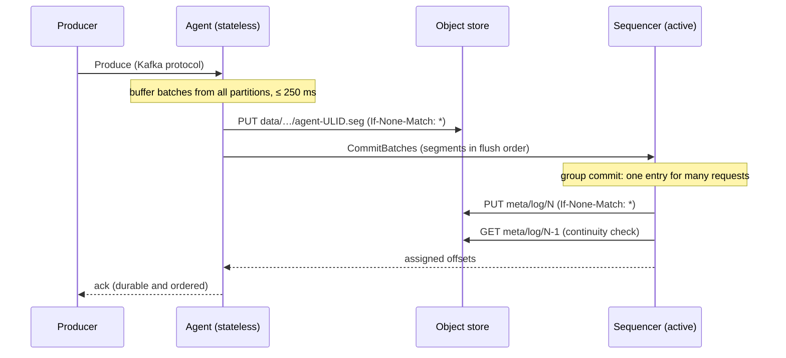

# Sluice

**A Kafka-compatible streaming log with no broker disks.** Agents speak the Kafka protocol and hold no durable state, one sequencer
orders everything through a metadata log fenced by object-store conditional writes, and an S3-compatible bucket (Cloudflare R2, MinIO,
AWS S3) is the only durable layer. Unmodified Kafka clients produce, consume and run consumer groups against it, and a deterministic
simulator plus a history checker back the claim that no acknowledged record is ever lost.

[Design](docs/DESIGN.md) · [Bugs the simulator found](docs/BUGS.md) · [Benchmarks](docs/BENCHMARKS.md) · [Runbook](docs/RUNBOOK.md) ·
[Decision records](docs/adr)

## Headline numbers

Every number links to the script and raw output that produced it. Measured on a laptop (Intel i5-12450H, 16 GB, Windows 11), so treat
them as a reproducible baseline rather than production figures.

| | Result | Evidence |
| --- | --- | --- |
| Simulated client operations on the final code, 0 invariant violations | **3.29 M** across 6,000 seeds with crashes, zombie pauses, partitions, storage errors and lost responses | [BENCHMARKS.md#correctness](docs/BENCHMARKS.md#correctness) |
| Bugs found by the simulator | **8**, three of which lost acknowledged data; each with seed, root cause, fix and regression test | [BUGS.md](docs/BUGS.md) |
| Live chaos: real processes `kill -9`'d (4 agents, the active sequencer) | **71,133** idempotent sends, all acked, **0 violations**; longest produce stall 3.5 s | [BENCHMARKS.md#live-chaos](docs/BENCHMARKS.md#live-chaos) |
| Produce latency, 250 ms flush window, 30–70 ms injected storage latency | **p50 389 ms, p99 690 ms** at 2 MB/s | [BENCHMARKS.md#latency-vs-cost](docs/BENCHMARKS.md#latency-vs-cost) |
| Object-store writes | **5,650 PUTs per GB** at the default window; 405 per GB with full segments | [BENCHMARKS.md#latency-vs-cost](docs/BENCHMARKS.md#latency-vs-cost) |
| Throughput (open loop, two agents, one laptop) | **73 MB/s** | [BENCHMARKS.md#throughput](docs/BENCHMARKS.md#throughput) |
| Client compatibility | franz-go, librdkafka (confluent-kafka-python), kafka-python: produce, consume, groups, offsets, idempotent producer | [test/compat](test/compat) |

## How it works



* **Fencing without consensus.** Only one writer can create `meta/log/N`, and a writer appends N only after applying everything below
  it, so two sequencers that both think they lead cannot diverge. Leases only decide who tries.
* **Garbage collection that stays safe.** Put-if-absent proves a slot is empty, not that it was never written, so log GC deletes in
  ascending order and every writer confirms its predecessor entry after winning a slot (the simulator found the bug that needed this).
* **Raw batches.** Client bytes are stored untouched; fetches patch the base offset, which Kafka's batch CRC does not cover.
* **Deterministic simulation.** The agent and sequencer are sans-I/O state machines that the simulator runs single-threaded in virtual
  time, with a fault-injecting network and object store; every failure replays from one 64-bit seed.

Read [DESIGN.md](docs/DESIGN.md) for the full argument and the deviations from the original plan.

## Quick start

Requirements: Go 1.27. Docker is optional.

```bash
go run ./cmd/sluice-dev
```

That starts two sequencers and two agents in one process, storing everything under `./sluice-data`. Kafka is on `127.0.0.1:9092`
(agent-1) and `127.0.0.1:9093` (agent-2); the playground API is on `127.0.0.1:8080`. (Use `127.0.0.1` rather than `localhost`: the dev
listeners are IPv4-only, and some clients try `::1` first.)

```bash
go run ./cmd/sluicectl create -b 127.0.0.1:9092 -topic orders -partitions 3
```

```bash
kcat -b 127.0.0.1:9092 -t orders -P -l /etc/hosts
```

```bash
kcat -b 127.0.0.1:9092 -t orders -C -o beginning -e
```

Then see where a record lives, straight from the bucket:

```bash
go run ./cmd/sluicectl inspect -store file://./sluice-data -cluster dev -topic orders -partition 0 -offset 0
```

The browser playground (produce, inspect, kill an agent) runs against the same cluster:

```bash
cd web && npm install && npm run dev
```

The full local stack with MinIO, Prometheus and Grafana:

```bash
docker compose -f deploy/docker-compose.local.yml up --build
```

## Verify it yourself

```bash
go test ./...                                     # unit, property, simulation, end-to-end
go run ./cmd/sluice-sim -seeds 500 -determinism   # 500 fault schedules, each replayed twice
go run ./cmd/sluice-sim -seed 42 -trace           # one seed with its full event trace
go test -tags sluice_bugs -run Planted ./internal/sim   # the checker catches four planted bugs
test/compat/run.sh                                # kcat, kafka-python, confluent-kafka (needs Docker)
```

## Repository layout

```
cmd/
  sluice-agent/      Kafka listeners, playground HTTP API, admin endpoint
  sluice-sequencer/  active or standby sequencer
  sluice-dev/        whole cluster in one process
  sluice-sim/        deterministic simulator: -seed, -seeds N, -trace, -determinism
  sluice-check/      invariant checker over a bucket (and a chaos history)
  sluice-bench/      latency, throughput and PUTs-per-GB measurements
  sluice-chaos/      live fault injector against a real cluster
  sluicectl/         topics, groups, log, replay, inspect, dump
internal/
  agent/ sequencer/  the deterministic cores
  protocol/          Kafka wire protocol: framing, SASL, quotas, pipelining
  runtime/ node/     real goroutines, gRPC and listeners around the cores
  sim/ checker/      simulator, workload and invariants I1–I7
  objstore/ segment/ metalog/ kbatch/ cache/ placement/ httpapi/ metrics/
proto/               metadata log, snapshot and internal RPC schemas
deploy/              production and local compose stacks, Caddy, Prometheus, Grafana
web/                 playground (Vite, TypeScript, Preact)
test/                end-to-end and client compatibility tests
docs/                design, bugs, benchmarks, runbook, decision records
```

## Status and scope

Supported: Produce (RecordBatch v2, acks 0/1/all, idempotent producer), Fetch with long polling, ListOffsets, Metadata, CreateTopics,
DeleteTopics, the classic consumer group protocol, offset commits, DescribeConfigs, SASL/PLAIN over TLS, per-user quotas, retention,
segment merging and garbage collection.

Not supported: transactions, compaction, the KIP-848 consumer protocol, fetch sessions, ACLs. Sluice is a learning-grade
reimplementation of the diskless-Kafka architecture (KIP-1150, WarpStream, Bufstream), not a competitor to them.

Install the tools with `go install github.com/ayushhh1010/sluice/cmd/...@latest`, or pull the multi-arch image
`ghcr.io/ayushhh1010/sluice`.

License: MIT.
