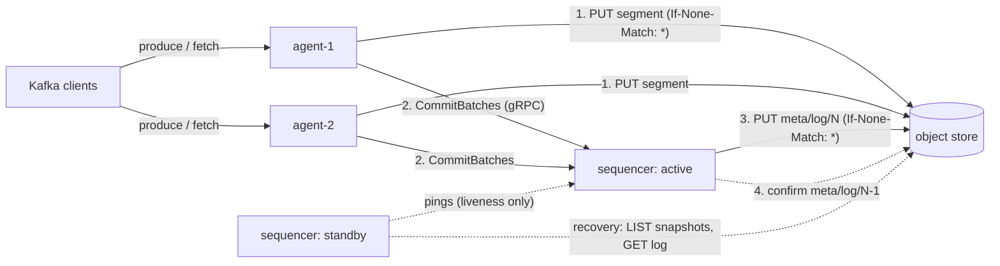

# Sluice design

Sluice is a Kafka-wire-compatible streaming log. Agents speak Kafka and hold no durable state; one active sequencer orders everything;
an S3-compatible object store holds every byte that matters. This document gives one section per decision, with the alternatives
rejected, and ends with the deviations from the PRD and the places where the design stops scaling.

The one rule everything rests on: **nothing is acknowledged until it is durable in object storage and ordered in the metadata log.**



## Contents

1. [Object storage is the only durable layer](#1-object-storage-is-the-only-durable-layer)
2. [Fencing with put-if-absent](#2-fencing-with-put-if-absent)
3. [Garbage-collecting a put-if-absent log](#3-garbage-collecting-a-put-if-absent-log)
4. [The write path and when we acknowledge](#4-the-write-path-and-when-we-acknowledge)
5. [Raw batches, offsets patched on read](#5-raw-batches-offsets-patched-on-read)
6. [Group commit at three levels](#6-group-commit-at-three-levels)
7. [Retries, deduplication and the two clock assumptions](#7-retries-deduplication-and-the-two-clock-assumptions)
8. [The read path](#8-the-read-path)
9. [Partition placement is a hint](#9-partition-placement-is-a-hint)
10. [Consumer groups](#10-consumer-groups)
11. [Idempotent producer](#11-idempotent-producer)
12. [Merging, retention and garbage collection](#12-merging-retention-and-garbage-collection)
13. [Deterministic simulation](#13-deterministic-simulation)
14. [Forwarding Kafka APIs to the sequencer](#14-forwarding-kafka-apis-to-the-sequencer)
15. [Cost model and cost guard](#15-cost-model-and-cost-guard)
16. [Deviations from the PRD](#16-deviations-from-the-prd)
17. [Where the design stops scaling](#17-where-the-design-stops-scaling)

## 1. Object storage is the only durable layer

**Decision.** Segments, the metadata log and snapshots are immutable objects in one bucket (Cloudflare R2 in production, MinIO or a
local directory in development). Agents and sequencers can be killed at any moment; a fresh VM pointed at the bucket is a full disaster
recovery.

**Why.** It removes cross-zone replication (the dominant cloud cost of classic Kafka), every stateful service other than the bucket,
and the whole category of "disk on broker 3 is corrupt" failures.

**Rejected.** A disk-based hot tier (lower latency, but it reintroduces broker state and replication); Postgres or etcd for metadata
(another stateful service; see ADR-002 — the `objstore.Store` interface keeps that swap cheap).

**Key layout** (`internal/metalog`):

```
sluice/<cluster>/data/<yyyy>/<mm>/<dd>/<agent>-<ulid>.seg      agent segments, many partitions each
sluice/<cluster>/merged/<topic-id>/<partition>/<base>-<ulid>.seg
sluice/<cluster>/meta/log/<seq:020d>.entry                    metadata log, one object per entry
sluice/<cluster>/meta/snap/<seq:020d>.snap                    snapshots
```

Sequence numbers are zero-padded to 20 digits so lexical order is numeric order. There is no `meta/head` pointer; see §3.

## 2. Fencing with put-if-absent

**Decision.** Appending entry N is `PUT meta/log/N` with `If-None-Match: *`. A sequencer writes N only after applying every entry
below N. Leases (pings between sequencers) decide only *who tries*; storage decides *who wins*.

**Why it is safe.** Only one writer can ever create N. If my write of N succeeds, my view of the prefix was complete, so the entry is
consistent with the true log. If I get a 412, I read N: if it is byte-identical to mine, an earlier attempt of mine landed (the response
was lost); otherwise someone else owns N, and since epochs only grow along the log, they are a newer leader and I step down. Two
sequencers that both believe they lead cannot diverge; they only waste requests until one steps down.

**Liveness only.** A standby pings the leader every second and takes over after `leader.timeout` without a leader. A leader also HEADs
its next slot every second, which bounds how long a deposed leader serves stale *reads* (writes are already impossible). A request
that carries a higher epoch than the leader's makes it step down at once. A restarting sequencer waits two ping rounds before its first
takeover attempt, and a standby treats a peer that is *recovering* as alive for up to `leader.timeout`, which removed a double failover
seen in the live chaos run (BUGS.md #14).

**Recovery** (`sequencer.Core.startRecovery`): LIST `meta/snap/` and load the newest snapshot; GET `meta/log/S+1, S+2, …` applying each
until a 404 at N; PUT `meta/log/N = BecomeLeader{epoch+1}`. If that loses to another node's `BecomeLeader`, defer to it rather than
deposing a leader that is evidently alive. Probing uses GETs, not LIST, because LIST is a billed write-class operation on R2.

**Rejected.** ZooKeeper, KRaft or a Raft group (a consensus service to run and argue about, which object storage already provides for
this one operation); time-based leases for safety (a paused process cannot know its lease expired).

## 3. Garbage-collecting a put-if-absent log

Put-if-absent proves a slot was *empty*, not that it was *never written*. Once old log entries are deleted, that difference matters.
Two real bugs came from it (BUGS.md #3, #16); the rules below close them.

**Zombie append into a deleted slot (found by the simulator, seed 78).** A leader pauses while retrying the PUT of slot N. The new
leader appends, snapshots twice and garbage-collects entries ≤ N. The zombie resumes, its PUT of N *succeeds* (the slot is empty), it
applies the entry and acknowledges offsets that live in a dead zone no recovery will ever read.

**Rule 1 — deleted entries always form a prefix.** Log GC deletes entries one at a time in ascending order and advances its floor only
after the whole range is gone; every round, by any leader, starts at or below the end of the deleted prefix.

**Rule 2 — confirm the predecessor after winning a slot.** After winning slot N (by PUT or by a 412 on our own landed write), the writer
GETs N−1 and checks it is byte-identical to the entry it applied there (the SHA-256 travels in snapshots for the first append after
recovery). If N had been deleted, then by Rule 1 so had N−1, so the check fails and the writer steps down without acknowledging. This
costs one GET per append and no clocks. `TestWinningAGarbageCollectedSlotStepsDown` pins it. Slot 1 has no predecessor, so a writer that wins it instead LISTs
`meta/snap/` and requires it to be empty: GC never runs before two snapshots exist, so any snapshot means slot 1 was written and later
deleted. The nightly simulator found that hole (BUGS.md #17): a node listed no snapshots, was paused mid-recovery, and resumed after GC
to lead from an empty state. A writer that fails the check leaves its rejected entry below the GC floor: a few hundred
bytes that recovery never reads.

**Rule 3 — recovery starts from the newest snapshot that exists, found with LIST.** The PRD's `meta/head` hint is unsafe: a zombie can
rewrite it to point at an old snapshot whose following entries were already deleted, and recovery would then probe into the deleted
range and claim a slot below the real end of the log. Entries above the second-newest snapshot are never deleted, and no snapshot can
be newer than the true log, so recovering from the maximum snapshot never probes a hole. One LIST per failover is the cost.

**Rule 4 — snapshots below the GC floor are deleted by LIST, not by memory.** A new leader only knows the snapshots in its own chain;
snapshots written by others leaked until GC started listing them (BUGS.md #4).

## 4. The write path and when we acknowledge

1. The client sends Produce to the agent Metadata named as leader. Any other agent answers `NOT_LEADER_OR_FOLLOWER`.
2. The protocol layer validates each batch (magic 2, CRC32C, record counts, size, no transactional or control batches) before any core
   sees it, and submits the request to the agent core *on the connection's reader goroutine*, so requests enter the core in arrival
   order.
3. The agent appends the batches to its flush buffer, which mixes all partitions. It flushes when the oldest batch reaches
   `flush.window` (250 ms) or the buffer reaches `flush.max.bytes` (4 MiB), and never flushes an empty buffer.
4. The agent picks one key (a ULID) and PUTs the SLC1 segment with `If-None-Match: *`. Retries reuse the key; a 412 on a retry means an
   earlier attempt landed.
5. The agent commits uploaded segments **in flush order**, all ready segments in one `CommitRequest` (§6).
6. The sequencer plans offsets for every batch, appends one entry for many requests, confirms the predecessor (§3) and only then
   applies the entry to memory.
7. The agent completes each Produce with its base offset and copies the batches into its tail cache.

Any failure before step 6 completes returns a retriable error, never a success. A request that times out (`REQUEST_TIMED_OUT`) may
still commit later; that is the at-least-once window, and the checker allows exactly that.

**Latency budget:** flush wait (≤ window, ~half on average) + segment PUT + wait for the in-flight metadata append + metadata PUT +
predecessor GET + two network hops. BENCHMARKS.md measures it.

**Pipelined connections.** Kafka brokers process one request per connection at a time. Here every produce waits for a flush window,
so serial processing stacked windows for any client with several requests in flight (franz-go keeps up to five): 270 ms single-shot
became 2.5 s under load (BUGS.md #12). The server now pipelines: the reader submits each request in order and queues a reply; the
writer answers strictly in request order. Ordering per partition survives because requests enter the agent in order, the buffer keeps
that order, and commits go out in flush order.

## 5. Raw batches, offsets patched on read

Batches are stored exactly as the client sent them, compressed or not, grouped by partition inside the SLC1 segment (header, body,
footer of entries, trailer with the footer's CRC32C). Kafka's batch CRC covers `attributes` through the end of the batch, not
`baseOffset` or `partitionLeaderEpoch`, so the fetch path writes the assigned base offset into a copy of the header and never
re-encodes, recomputes a CRC or decompresses. That is also why a batch can be uploaded before it has offsets. (ADR-004)

## 6. Group commit at three levels

* **Agent buffer.** One segment per flush carries batches for every partition the agent owns: object-store PUTs scale with agents and
  flush windows, not with partitions.
* **Agent commits.** An agent keeps one `CommitRequest` in flight. Segments that finish uploading meanwhile go out together, in flush
  order, in the next request, and the sequencer plans them in that order. Serializing one segment per round trip capped throughput at
  small flush windows (BUGS.md #13); batching keeps order without the cap.
* **Sequencer entries.** The sequencer has one append in flight. Requests that arrive meanwhile (from all agents, plus offset commits,
  topic changes, producer-ID allocations, merges and retention) are planned into the next entry, so one PUT carries many operations.
  Entries hold a list of operations of different kinds (the PRD had one operation per entry), applied in a fixed kind order: commits,
  offset commits, topic creations, producer IDs, merges, truncations, deletions. Planning therefore needs overlays only for next
  offsets, producer sequence state, new topic names and producer IDs; a commit planned in the same entry as a create or delete of its
  topic is conservatively rejected.

## 7. Retries, deduplication and the two clock assumptions

A lost `CommitBatches` reply is retried with the same object key. The sequencer answers from `RecentByKey` (the last 8,192 commits, kept
in snapshots so answers survive failover), or joins the attempt already queued, or refuses a key that already has refs or a tombstone.

**Bug found by the simulator (seed 1037, BUGS.md #5):** an agent's retry outlived the object: the segment's refs were merged away, it was
tombstoned, GC deleted it and dropped the tombstone, and the late retry then looked brand new and was committed again, pointing at a
deleted object. The fix makes the existing age check sufficient: commits for segments older than `max_segment_age` (2 min) are refused,
and GC waits at least `2 × max_segment_age` before deleting. `Config.setDefaults` enforces it.

Safety is clock-free everywhere except these two margins, both at least 1.5×, against skew between machines that share an NTP source
(in production all processes share one VM clock):

| Margin | Rule | Default |
| --- | --- | --- |
| Commit retry vs GC | `gc.grace ≥ 2 × max_segment_age` | 10 min ≥ 4 min |
| Orphan sweep vs late commit | `orphan.min_age ≥ 1.5 × max_segment_age` | 60 min ≥ 3 min |

## 8. The read path

The agent that owns a partition serves its fetches from, in order: the **tail cache** (committed batches it wrote itself, so tail
consumers never touch object storage), the **index cache** (batch locations from earlier lookups) plus the **data LRU** of object byte
ranges (512 MiB), and finally a ranged GET; adjacent ranges in one object are coalesced. A fetch at the high watermark long-polls until a
commit (its own, or a watch notification from the sequencer) or `MaxWaitMs`. Every pass recomputes from the caches and starts only the
I/O it is missing, so the fetch state machine has no bespoke states.

If an object was merged or deleted after its refs were cached (the GC grace covers any fetch that resolved a ref before it was dropped),
the GET returns 404, the agent forgets the refs and looks up again. Fetch sessions are not supported: responses always carry session
ID 0, which clients accept as "full fetches". Empty partitions return an empty, non-null record set (librdkafka rejects null; BUGS.md
#11).

## 9. Partition placement is a hint

`owner(partition)` is rendezvous hashing over live agents (heartbeat every second, five-second TTL). Metadata reports the owner as
leader. Ownership only routes traffic for cache locality: offsets come from the sequencer, so two agents briefly disagreeing during a
handoff cannot corrupt anything; the worst case is a `NOT_LEADER_OR_FOLLOWER` and a metadata refresh. An agent that sees an unknown
topic refreshes its topic list before answering, so a topic created a moment ago never looks missing (BUGS.md #9).

## 10. Consumer groups

The sequencer runs the classic coordinator (Empty → PreparingRebalance → CompletingRebalance → Stable) with KIP-394 member IDs,
session and rebalance timeouts, and protocol voting. Membership lives in memory; after a failover members get `UNKNOWN_MEMBER_ID` and
rejoin. Committed offsets go through the metadata log and are acknowledged only after the append.

* **Generations never repeat.** New groups start at `epoch << 16`, and a per-name floor survives in-memory cleanup of empty groups. Both
  were simulator finds (BUGS.md #1, #2): repeated generation numbers would let two incarnations of "generation 1" mix.
* **Linearizable OffsetFetch.** A deposed leader could otherwise answer OffsetFetch from stale memory for up to a second, returning an
  offset older than one already acknowledged. OffsetFetch now waits for a *read barrier*: a HEAD of the next log slot, started after the
  request arrived, must return 404 (or an append must complete) before it answers. Fetch, Metadata and ListOffsets stay barrier-free:
  a stale answer there is a prefix of the truth, which clients handle.

## 11. Idempotent producer

`InitProducerId` allocates IDs through the log (one `AllocProducerIds` operation each, group-committed), so IDs never repeat across
failovers. The planner keeps the last five sequence ranges per producer and partition: a repeated range returns the original offset, a
gap returns `OUT_OF_ORDER_SEQUENCE_NUMBER`, an older epoch `INVALID_PRODUCER_EPOCH`. Producer state is rebuilt by replay, so it
survives failover. franz-go and librdkafka enable idempotence by default; both pass the compatibility tests with it on. Transactions are
out of scope.

## 12. Merging, retention and garbage collection

* **Merging.** The sequencer picks a run of at least 16 small refs in agent segments, coalesces ranged GETs, writes one merged segment
  for the partition with put-if-absent and appends `ReplaceObjects`. At apply time only refs that are still current are swapped.
* **Retention.** Periodically the leader finds, per partition, the first batch whose max timestamp is within `retention.ms` and appends
  a truncation. Public `pg-` topics also expire after 24 hours.
* **Tombstones are implicit.** The PRD logged `MarkDead` operations. Here, applying an entry that drops an object's last ref tombstones
  it with deadline `entry.written_unix_ms + gc.grace`. Apply is still deterministic (the deadline comes from the entry), there is one
  operation fewer per drop, and no window in which a leader crashed after dropping refs but before logging the tombstone. Apply
  refuses (as log corruption) any entry that would give a tombstoned object a new ref.
* **Deletion.** The leader deletes tombstoned objects after their deadline. Conditional deletes are never relied on (R2 has been observed
  ignoring `If-Match` on DELETE).
* **Orphan sweep.** Hourly, objects in `data/` and `merged/` older than an hour that no ref, tombstone or pending commit names are
  deleted. Before deleting, the leader re-checks that its next log slot is still empty: a paused zombie running a stale sweep would
  otherwise delete objects the real leader committed.

## 13. Deterministic simulation

The agent and sequencer are sans-I/O state machines: `Step(now, event) → []effect`. They never read the clock, use global randomness,
start goroutines or import I/O packages; `internal/sim/purity_test.go` enforces that with the Go AST on every test run. Production
drives them with goroutines and sockets (`internal/runtime`); the simulator drives the same code on one thread in virtual time:

* a priority queue of events ordered by virtual time, ties broken by insertion order, and one splitmix64 generator seeded from the run's
  64-bit seed for every random choice (node clock skew included);
* a simulated network with latency, drops and partitions, and messages re-encoded through protobuf as the wire would;
* a linearizable object store with real conditional-PUT semantics that injects 503s, slowdowns and "applied but response lost" writes;
* crashes at any step (all memory lost), restarts, pauses long enough to create zombies, partitions and isolation;
* a workload of plain and idempotent producers, fetchers, offset committers and group members;
* BUGGIFY: every seed randomizes flush windows, cache sizes, snapshot frequency, merge thresholds, dedup cache size, GC timings and
  fault rates.

The checker (`internal/checker`) verifies I1–I7 plus G1 (no partition has two owners in one generation) from the history and the
bucket, and the simulator also checks every leader's internal consistency continuously. Planted bugs (`-tags sluice_bugs`) prove the
checker is not vacuous: `make planted` fails unless all four are caught. CI replays every seed twice and compares fingerprints.

**Limits.** Determinism holds at the core boundary only: Go's scheduler is not deterministic across threads, so the runtime wrappers,
the Kafka codec and the gRPC transport are covered by the compatibility, end-to-end and live chaos tests instead.

## 14. Forwarding Kafka APIs to the sequencer

Agents implement ApiVersions, SASL, Produce and Fetch. Every other supported API (Metadata, topics, ListOffsets, FindCoordinator, the
group APIs, offsets, InitProducerId, DescribeConfigs) is forwarded as raw Kafka request bytes inside one gRPC envelope and answered by
the sequencer with `kmsg` types. There is exactly one implementation of each API, the internal RPC surface stays two methods (`Call`
and `Watch`), and the simulator exercises the same group coordinator real clients hit. If forwarding fails the agent closes the
connection, the one error every client handles for every API.

## 15. Cost model and cost guard

R2 bills PUT and LIST as Class A ($4.50 per million) and GET and HEAD as Class B ($0.36 per million), with 1 M and 10 M free per month.
With A agents under continuous load, flush window w and E metadata entries per second, PUTs/s ≈ A/w + E. Idle clusters make no Class A
requests: agents never flush empty buffers, and the leader's background HEADs are Class B.

The sequencer counts Class A operations per UTC day (its own plus what agents report in heartbeats). At `--cost-guard-daily` (30,000 by
default, about 0.9 M a month) public listeners turn read-only until midnight and the playground shows a banner. The counter is in
memory, so a sequencer restart resets it; restarts are rare, and this is documented in the runbook.

## 16. Deviations from the PRD

| PRD | Sluice | Why |
| --- | --- | --- |
| `meta/head` snapshot hint | LIST newest snapshot on recovery | A stale hint after log GC lets recovery rewrite history (§3) |
| Put-if-absent alone fences writers | Plus predecessor confirmation and ascending GC | Deleted slots can be "won" (§3) |
| One operation per entry | Many operations per entry | One PUT for commits, offsets and admin together |
| `MarkDead` operations | Tombstones derived at apply time | Fewer PUTs, no crash window (§12) |
| `CommitBatches` per segment | Ordered multi-segment commits | Order and throughput (§6) |
| One request per connection | Pipelined, ordered replies | Flush windows stacked under load (§4) |
| Typed gRPC per API | Raw Kafka forwarding | One implementation per API (§14) |
| certmagic in agents | Caddy issues certificates, agents hot-reload them | Caddy already holds ports 80 and 443 |
| Separate merger core | Merger inside the sequencer core | Shares state; still deterministic and simulated |
| `head`-based snapshot GC | Second-newest-snapshot floor plus LIST | See Rule 4 (§3) |

## 17. Where the design stops scaling

* **One sequencer.** Throughput is capped at metadata entries per second (one PUT plus one GET per entry, so roughly 5–15 per second on
  R2) times batches per entry. Group commit makes batches per entry grow with load, so the practical ceiling is the sequencer's CPU and
  the in-memory batch index. To go further, shard the sequencer by partition range: each shard owns a disjoint set of partitions and
  its own log prefix (`meta/<shard>/log/`), agents route commits by partition, and topic creation goes through a small directory log.
* **One batch ref per Kafka batch** in memory. At demo scale this is megabytes. Past that, index per object range and read batch
  positions from segment footers on demand.
* **Single VM.** One failure domain; process kills still prove statelessness, and a second VM for agent-2 is a configuration change.
* **Latency.** Diskless means hundreds of milliseconds, not single digits. The knobs are the flush window and producer linger; the
  measured curve is in BENCHMARKS.md.
